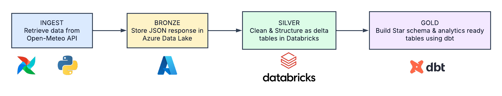
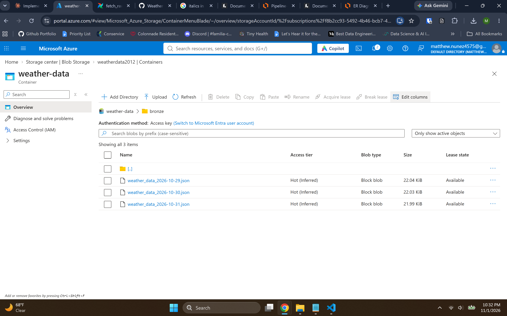
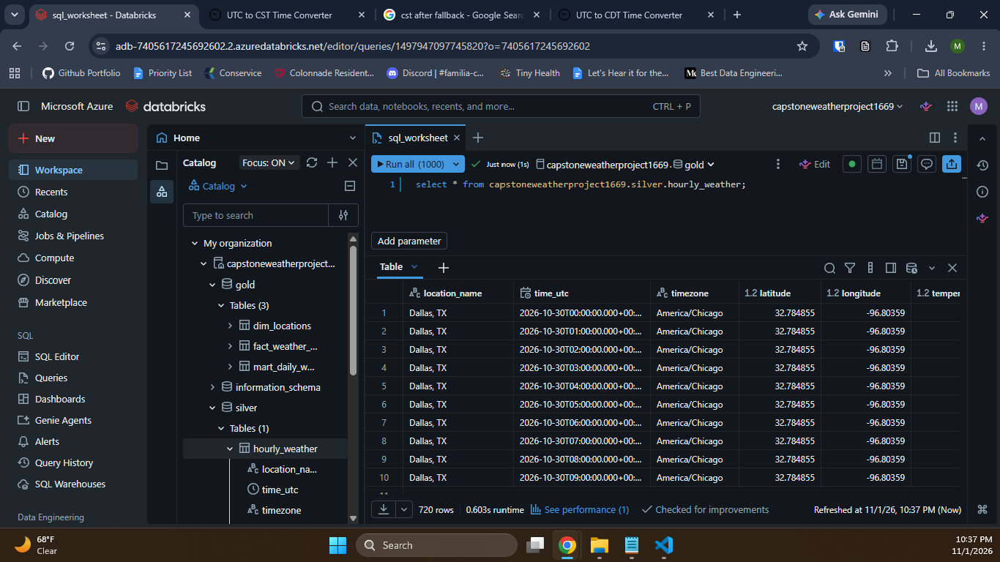
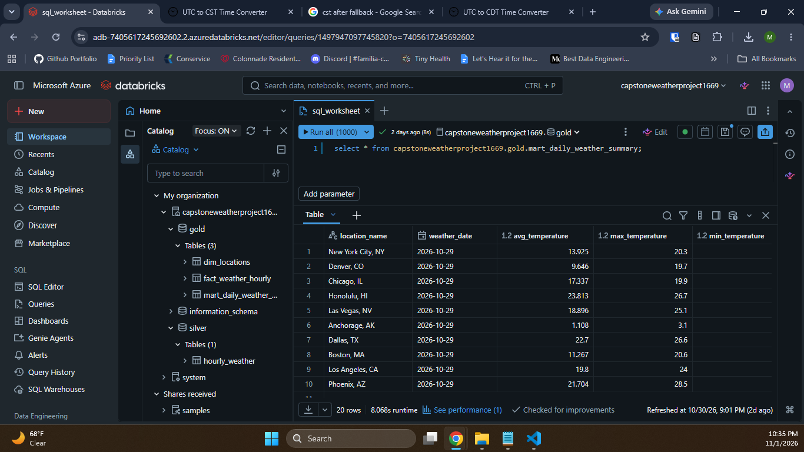
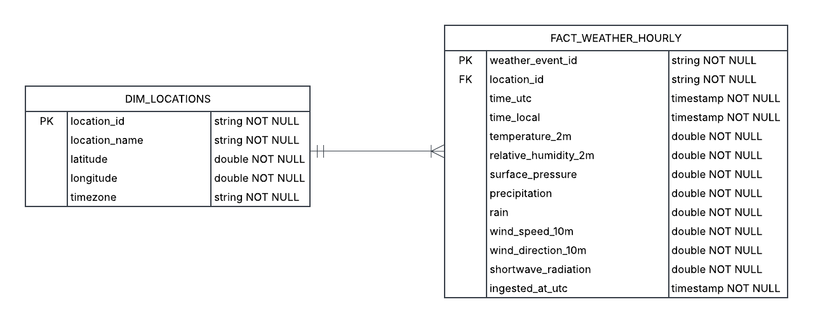

# Historical Weather Pipeline

## Project Overview

### Description
An end-to-end weather data pipeline that transforms hourly observations for 10 U.S. cities into query-ready Databricks tables. Its daily summaries support comparing weather across cities or tracking selected metrics for one city over time.

### Tech Stack
- **Data source:** Open-Meteo Weather API
- **Orchestration:** Apache Airflow
- **Runtime:** Python, Docker Compose
- **Cloud storage:** Azure Data Lake Storage
- **Processing and table format:** PySpark, Delta Lake
- **Data platform and catalog:** Databricks
- **Analytics modeling and testing:** dbt, SQL

### Schedule
Airflow job runs daily at 14:00 UTC in a local Docker Compose environment, orchestrating the pipeline for the previous day’s hourly observations, about 240 records across 10 cities per run.

### Pipeline Workflow

1. **Ingest:** A Python task running in Docker retrieves the previous day’s hourly weather data from the Open-Meteo API.
2. **Store raw data (Bronze):** Save the API response as JSON in Azure Data Lake Storage.

    
3. **Transform (Silver):** Use PySpark to clean and structure the raw data as a Delta table in Databricks.

    
4. **Model (Gold):** Use dbt and SQL to build a location dimension, an incremental hourly weather fact table, and daily city-level summaries of temperature, humidity, precipitation, wind speed, and solar radiation.

    

### Physical Entity Relationship Diagram

DIM_LOCATIONS stores one record per location, including its name, coordinates, and timezone.

FACT_WEATHER_HOURLY stores timestamped weather measurements and ingestion metadata. Each weather record references one location through location_id; each location can have one or more hourly weather records.

### Data quality and reliability
Airflow tasks are configured for three retries. Before merging, the Silver-layer job checks that its input is non-empty and contains no duplicates; dbt tests model keys for uniqueness and non-null values. Failed runs are visible in Airflow and can be manually rerun or backfilled by logical date.

### CI/CD Workflows
